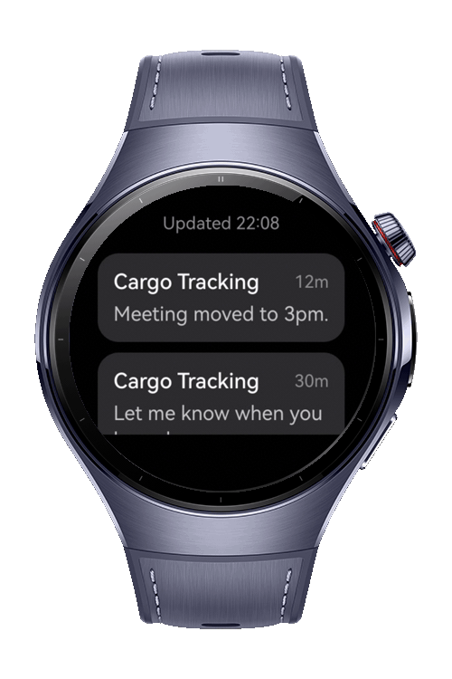

> **Note:** To access all shared projects, get information about environment setup, and view other guides, please visit [Explore-In-HMOS Index](https://github.com/Explore-In-HMOS/hmos-index).

# How to Build Swipe to Refresh?

Pull-to-refresh on HarmonyOS wearables a watch message list built with ArkUI's Refresh component and mock data.

# Preview

<div>
 
</div>

# Use Cases

-  Wiring Refresh to a List on a wearable target

# Technology

## Stack

- **Languages**: ArkTS
- **Frameworks**: HarmonyOS SDK 5.1.0(21)
- **Tools**: DevEco Studio Vers 6.0.1.251
- **Libraries**: @kit.ArkUI`

# Directory Structure

```
├── entry/
   └── src/main/
       └── ets/
           ├── entryability/EntryAbility.ets
           ├── entrybackupability/EntryBackupAbility.ets
           └── pages/Index.ets
```

# Constraints and Restrictions

## Supported Devices

- Huawei Watch 5
- DevEco Studio Simulator

# License

**How to Build Swipe to Refresh?** is distributed under the terms of the MIT License
See the [LICENSE](./LICENSE) for more information.